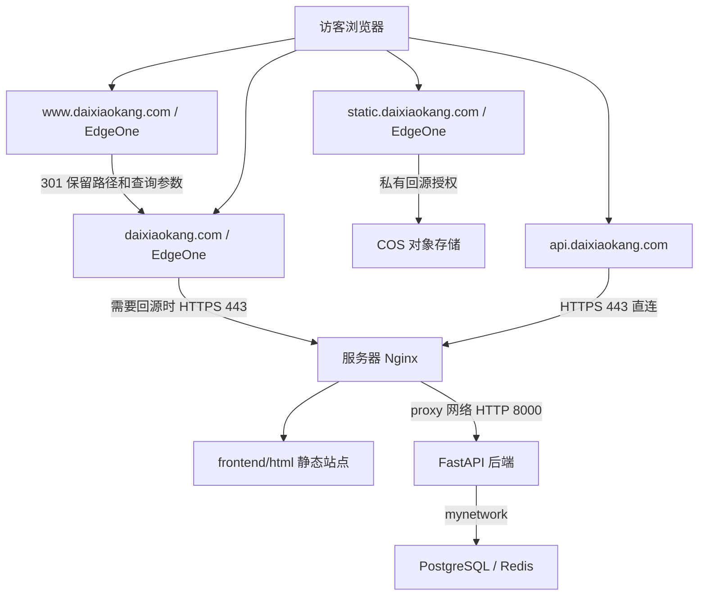

# 当前线上配置与迁移手册

配置基线：2026-11-03。适用于现有的 **Hexo 静态站点 + Nginx + FastAPI + PostgreSQL + Redis + EdgeOne + COS** 部署。

本文可作为迁移操作入口；实际配置从同目录说明及仓库示例恢复。密码、模型密钥、腾讯云密钥、证书私钥不记录在公开文档中，需另行私密备份。控制台开关不能全部由公网响应反推，迁移前应导出或截图留存 EdgeOne 的实际规则及证书配置。

## 1. 当前请求路线



主站 JS、CSS 可由主站域名经过 EdgeOne 加速。自有图片和视频主要使用 static 域名；部分应急图和地图图标等仍在主站。第三方字体、脚本及 GitHub 贡献日历使用各自的服务。

## 2. DNS 与 EdgeOne

### 2.1 DNS 基线

| 主机记录 | 类型 | 当前记录值 | 迁移处理 |
| --- | --- | --- | --- |
| `@` | CNAME | `daixiaokang.com.eo.dnse2.com` | 同站点迁服务器通常保留；重建 EdgeOne 后改用控制台新分配的值 |
| `www` | CNAME | `www.daixiaokang.com.eo.dnse2.com` | 同上 |
| `static` | CNAME | `static.daixiaokang.com.eo.dnse2.com` | 同上 |
| `api` | A | `134.175.50.80` | 改为新服务器公网 IP |

`134.175.50.80` 是旧服务器地址，不应直接沿用到新服务器。新增 AAAA 前应确认新服务器及回源支持 IPv6，避免残留错误记录。域名转移注册商或 DNS 服务时，保留其他用途的记录。

### 2.2 EdgeOne 配置基线

| 域名 | 源站 / 行为 | 关键配置 |
| --- | --- | --- |
| `daixiaokang.com` | 服务器公网 IP | HTTPS 443 回源；回源 Host、TLS SNI 均为 `daixiaokang.com`，配置源站证书校验 |
| `www.daixiaokang.com` | 边缘重定向 | HTTP、HTTPS 均 301 到 `https://daixiaokang.com`，保留路径、查询参数；www 自己也要有效边缘证书 |
| `static.daixiaokang.com` | 腾讯云 COS 私有桶 | 选择对应桶和地域，开启私有访问授权，配置 static 边缘证书 |
| `api.daixiaokang.com` | 直连服务器 | 当前不接入 CDN，不应将其 DNS 改成主站 CNAME |

目前 www 跳转的实测 URL 带默认端口 `:443`，不影响使用。www 不回源处理跳转，因此当前服务器 Nginx 和源站证书不包含 www。

配置规则时限制主机匹配范围，避免将 COS 源站、www 重定向或强制缓存规则应用到其他域名。主站保留 `/api` 和 `/api/*` 不缓存的兼容规则；其中的关系是“当前主机下匹配任一路径”，不是要求路径同时满足两项。

### 2.3 缓存基线

| 内容 | 浏览器 / 源站响应 | EdgeOne 行为 |
| --- | --- | --- |
| HTML、search.xml、站点地图、robots.txt、Service Worker | `Cache-Control: no-cache` | 遵循源站校验策略，不能强制长时间缓存页面 |
| 主站成功的 CSS、JS、图片、字体、视频等 | `public, max-age=86400` | 遵循源站一天的缓存策略 |
| static 图片、视频 | 浏览器缓存 3600 秒 | 此前控制台配置节点缓存 15 天，迁移时核对并重建此规则 |
| `/api`、`/api/*` | `no-store` | 禁止缓存，错误响应也不能缓存成页面 |

`no-cache` 允许存储，但再次使用前需要校验；`no-store` 才是不存储。HTML 返回 MISS 不代表没有走 CDN。节点 15 天不能只靠浏览器响应头确认，应以控制台规则为准。

主站文本资源启用 gzip；API 在 Nginx 关闭 gzip、缓存和响应缓冲。视频需要保持正确 MIME、Range 和 206 响应。覆盖同名文件后刷新对应域名的 EdgeOne 缓存；浏览器的旧缓存可通过版本 URL 或强制刷新处理。

### 2.4 COS

当前使用广州地域的私有桶，历史配置记录的桶名为 `daixiaokang-static-1492511006`，操作前以当前腾讯云控制台为准。桶名不是访问凭据。

- 上传路径保留 `assets/` 前缀，例如 `assets/avatar.png`、`assets/home/pc_01.mp4`。
- 前端配置的媒体基地址已包含 `/assets`，不要在桶内多套一层目录。
- 私有桶依靠 EdgeOne 私有回源授权读取，不要为了修复 403 随意改为公有写。
- 同账号、同桶只迁移应用服务器时，COS 对象和 static 的源站通常无需修改。
- 迁移 COS 桶或云账号时，先复制对象并核对路径、类型及授权，再切换 static 源站、刷新缓存。

## 3. 服务器与本地文件对应关系

当前服务器项目目录：`/daixk/project/daixiaokang`；本地仓库：`G:\code\daixiaokang`。

| 本地文件 / 目录 | 服务器相对项目根目录的位置 | 说明 |
| --- | --- | --- |
| `docker-compose.yaml` | `docker-compose.yaml` | 实际容器配置 |
| 根目录 `nginx.conf` | `frontend/nginx.conf` | 位置不同，内容按统一配置维护 |
| `frontend/public/` 内的内容 | `frontend/html/` 内 | 构建产物，不要多套 public 目录 |
| `backend/` 源码 | `backend/` | 不上传 .venv、缓存；保留服务器私密配置 |
| `backend/.env.docker` | `backend/.env.docker` | Docker 正式配置 |
| `backend/data/geo/*.xdb` | `backend/data/geo/` | 地域库不进 Git，要单独同步或重新下载 |
| `deploy/` | `deploy/` | 脚本、Dockerfile、文档；隐藏 .dockerignore 也要保留 |
| 私密备份的 `deploy/https.env` | `deploy/https.env` | DNSPod 凭据及续期计划 |
| 私密备份的 `deploy/acme/` | `deploy/acme/` | ACME 账户、域名配置、续期状态 |
| 私密备份的 `frontend/ssl/` | `frontend/ssl/` | 源站证书及私钥 |

服务器目录基线：

```text
/daixk/project/daixiaokang/
├── docker-compose.yaml
├── backend/
│   ├── .env.docker
│   ├── main.py
│   ├── requirements.txt
│   ├── controller/ core/ db/ models/ schemas/ services/ ...
│   ├── data/geo/ip2region_v4.xdb
│   ├── data/geo/ip2region_v6.xdb
│   └── logs/
├── frontend/
│   ├── html/
│   ├── nginx.conf
│   ├── ssl/fullchain.pem
│   ├── ssl/privkey.pem
│   └── logs/
└── deploy/
    ├── https.env
    ├── acme/
    ├── acme.Dockerfile
    ├── acme-container.sh
    └── https.sh
```

依赖镜像构建目录独立于上面的应用目录，当前为 `/daixk/project/python_image_build/`。

## 4. 容器、网络与挂载

| 服务 | 镜像 | 端口 | 网络 |
| --- | --- | --- | --- |
| `daixiaokang_frontend` | `nginx:latest` | 公网 80、443 | `proxy` |
| `daixiaokang_backend` | `daixiaokang-backend-deps:latest` | 宿主机 `127.0.0.1:8000` | `proxy`、外部 `mynetwork` |
| `daixiaokang_acme` | `daixiaokang-acme:latest` | 无需入站端口 | Compose 默认网络 |

PostgreSQL 和 Redis 属于独立部署，不在本项目 Compose 中创建。新服务器必须先准备它们、迁移数据，并保证后端通过 `mynetwork` 能解析和连接实际服务名。

专用 `proxy` 子网为 `10.67.4.0/24`，Compose 自动创建，容器地址自动分配。后端的环境变量为：

```dotenv
FORWARDED_ALLOW_IPS=10.67.4.0/24
```

这个变量放在 Compose 的 `environment`，用于 Uvicorn 信任代理。Nginx 与后端必须共享此专用网络，其他服务不要接入。后端通过原有 `mynetwork` 访问数据库及 Redis。

迁移前检查所有 Docker 子网及宿主机路由：

```bash
docker network inspect $(docker network ls -q) --format '{{.Name}} {{range .IPAM.Config}}{{.Subnet}} {{end}}'
ip route
```

若 `10.67.4.0/24` 冲突，修改 Compose 的 `networks.proxy.ipam.config[].subnet`，并同步修改 `FORWARDED_ALLOW_IPS`。不需要固定容器 IP。

`mynetwork` 为外部网络，Compose 不会替你创建。新服务器上若不存在，先选择不冲突的子网创建，例如原环境使用的 `10.67.3.0/24`；数据库和 Redis 也要接到这个网络：

```bash
# 仅在确认网络不存在，且该子网和宿主机路由不冲突后执行。
docker network create --driver bridge --subnet 10.67.3.0/24 mynetwork
```

容器名、网络名和数据库主机别名应以实际部署为准，不能只创建空网络就认为数据库已迁移。

挂载关系：

| 宿主机 | 容器内 | 权限 |
| --- | --- | --- |
| `frontend/html` | Nginx `/usr/share/nginx/html` | 只读 |
| `frontend/nginx.conf` | Nginx `/etc/nginx/nginx.conf` | 只读 |
| `frontend/ssl` | Nginx `/etc/nginx/ssl` | 只读 |
| `frontend/logs` | Nginx `/var/log/nginx` | 读写 |
| `backend` | 后端 `/backend` | 只读 |
| `backend/logs` | 后端 `/backend/logs` | 读写 |
| `deploy/acme` | ACME `/acme.sh` | 读写 |
| `frontend/ssl` | ACME `/certs` | 读写 |
| `/var/run/docker.sock` | ACME 同路径 | 用于检查和重载 Nginx |

## 5. HTTPS 与 Nginx

### 5.1 证书边界

| 连接 | 证书位置 / 管理方式 |
| --- | --- |
| 浏览器 → 主站 / www / static 的 EdgeOne | 三个域名分别在腾讯云配置边缘证书 |
| EdgeOne → 主站源站 Nginx | 服务器 `frontend/ssl/` 的源站证书 |
| 浏览器 → API Nginx | 同一套源站证书 |
| Nginx → FastAPI | 专用 Docker 网络内 HTTP |

服务器 ACME 脚本目前只申请 `daixiaokang.com`、`api.daixiaokang.com`，不含 www、static。源站证书与边缘证书是不同管理范围；迁移源站脚本不会自动迁移 EdgeOne 边缘证书。

`deploy/https.env` 填写 `ACME_EMAIL`、`Tencent_SecretId`、`Tencent_SecretKey`。使用具有对应域名 TXT 记录查询、创建、删除权限的 DNSPod API 凭据；不是旧版 DNSPod Token。

默认 `HTTPS_CRON='15 3 * * *'`，时区 `Asia/Shanghai`。容器启动时先检查，之后每日 03:15 检查，到续期窗口才签发；成功后安装证书，先 `nginx -t` 再 reload。没有宿主机 cron 依赖。

ACME 数据和证书需要一起私密备份，保留权限。迁移期间只让一台机器运行这套续期调度，避免两个实例同时修改 DNS 验证记录。不要删除原有账户目录来强制续期。

### 5.2 Nginx 行为

- 主站和 API 的 HTTP 80 跳转 HTTPS。
- 主站读取静态 HTML；不存在的普通页面 302 回首页。
- 缺失图片、JS、CSS 等资源保持 404，避免将 HTML 当作资源返回。
- 点文件路径，例如 `.env`、`.git`，返回 404。
- 主站和 API 域名的 `/api/` 保留完整路径代理后端；`/api` 308 到 `/api/`。
- API 禁止缓存、关闭响应缓冲及 gzip，读取超时 180 秒，适配 AI SSE。
- 使用 Docker DNS `127.0.0.11` 动态解析后端服务名，容器换 IP 不必手动改 Nginx。
- 覆盖外来 `X-Forwarded-For`，转发 `$remote_addr` 与 `$scheme`。
- API 直连时，后端能识别公网访客 IP。主站未设置 EdgeOne 来源 IP 信任，因此主站日志和旧 `/api` 兼容入口可能记录边缘节点 IP。

## 6. 前后端关键配置

前端站点 `_config.yml`：

```yaml
url: https://daixiaokang.com
```

前端 `_config.fomalhaut.yml` 中的以下字段（只展示需要核对的部分，勿用此片段覆盖整个文件）：

```yaml
site_media:
  base_url: https://static.daixiaokang.com/assets
feedback:
  api_base: https://api.daixiaokang.com/api
  local_api_base: http://localhost:8000/api
ai_chat:
  api_base: https://api.daixiaokang.com/api
  local_api_base: http://localhost:8000/api
site_analytics:
  enable: true
  api_base: https://api.daixiaokang.com/api
  local_api_base: http://localhost:8000/api
```

后端 `.env.docker`：

| 项目 | 必须核对的内容 |
| --- | --- |
| 环境 | `ENVIRONMENT=production`、`DEBUG=false`、`DOCS_ENABLED=false` |
| 数据库 | 实际账号、密码、库名，以及 `mynetwork` 中可访问的服务地址 |
| Redis | 实际服务地址、密码、数据库编号 |
| CORS | 允许 `https://daixiaokang.com`，按需要保留 `https://www.daixiaokang.com` 和本地开发来源 |
| 可信 Host | 至少包含主站和 `api.daixiaokang.com`；按用途保留 localhost 等 |
| AI | 服务地址、模型、密钥、限流等，使用自己的私密配置 |
| 自动建表 | `DATABASE_AUTO_CREATE=true` 可补建缺失表，不迁移已有表字段 |
| 统计 | `ANALYTICS_ENABLED=true`、`ANALYTICS_GEO_DIR=data/geo` |
| 日志 | `LOG_DIR=logs`，写入 backend/logs，轮转由后端日志配置管理 |

Compose 的 `env_file` 将 `.env.docker` 注入进程环境，不是让代码改为直接读取此文件。Pydantic 仍有 `.env` 读取逻辑，但同名进程环境优先。生产推荐使用完整 `.env.docker`，不要依赖随源码上传的开发 `.env`。

统计数据保存在 PostgreSQL 的 `site_visits` 表，迁移数据库时一起迁移。IPv4、IPv6 地域库不随 Git 分发；可复制现有两份 .xdb，或按 [ANALYTICS.md](../frontend/tools/ANALYTICS.md) 下载。新依赖镜像必须包含 `py-ip2region==3.0.6`。

## 7. 迁移操作顺序

### 7.1 备份与准备

1. 私密备份实际 Compose、Nginx、后端环境配置、https.env、ACME 账户及证书；本地真实 Hexo 配置和加密页面也要单独保留。
2. 对 PostgreSQL 做一致性备份并验证可恢复；评论、留言、AI 会话和统计都在数据库中。Redis 若承载需保留的业务状态，也按实际配置备份恢复。
3. 备份 COS 对象或确认原桶继续可用，留存 EdgeOne 规则、DNS 与边缘证书管理信息。
4. 准备新机器上的 Docker、Compose、端口 80/443、可用磁盘及不冲突网络；数据库和 Redis 先恢复到可用状态。
5. 切换前安排写入窗口：最终数据库备份前停止旧后端写入，防止迁移后遗漏新评论、会话或统计。不要直接复制运行中的 PostgreSQL 数据目录作为通用迁移方式。

同架构机器可在旧服务器导出当前镜像，避免重新下载造成版本变化：

```bash
docker image save -o daixiaokang-images.tar nginx:latest daixiaokang-backend-deps:latest daixiaokang-acme:latest
```

将 tar 私下传到新服务器后：

```bash
docker image load -i daixiaokang-images.tar
```

镜像不包含挂载的代码、数据库、环境配置、证书和前端页面，必须另外同步。CPU 架构不同时需要构建兼容镜像。

### 7.2 无现成镜像时构建

后端依赖镜像的构建目录包含最新 requirements.txt，Dockerfile 可按当前 Python 3.12 环境恢复：

```dockerfile
FROM python:3.12-slim
COPY requirements.txt /tmp/requirements.txt
RUN pip install --no-cache-dir -i https://mirrors.aliyun.com/pypi/simple/ -r /tmp/requirements.txt
```

从该目录执行：

```bash
docker build --no-cache -t daixiaokang-backend-deps:latest .
```

镜像只安装依赖，应用代码由 Compose 挂载运行。ACME 镜像由仓库 deploy/acme.Dockerfile 构建；Nginx 可加载已保存镜像或拉取支持 `http2 on` 的版本（至少 1.25.1）。

### 7.3 恢复应用目录

按第 3 节建立目录。首次只有 Git 示例时，参见 [CONFIGURATION.md](CONFIGURATION.md) 创建实际配置；已有私密备份优先恢复备份，避免把密码替换成示例占位符。

```bash
cd /daixk/project/daixiaokang
mkdir -p frontend/html frontend/logs frontend/ssl backend/logs deploy/acme
chmod 700 frontend/ssl deploy/acme
# 在恢复相应私密文件后执行：
chmod 600 backend/.env.docker deploy/https.env
docker compose config --quiet
```

构建前端（本地 Windows）：

```powershell
cd G:\code\daixiaokang\frontend
npm.cmd ci
npm.cmd run clean
npm.cmd run build
```

已经安装且依赖未变更时可跳过 npm ci。在 Git Bash 的 public 目录打包：

```bash
tar -czf ../frontend-public.tar.gz .
```

将压缩包上传至服务器 html，解压：

```bash
cd /daixk/project/daixiaokang/frontend/html
tar -xzf frontend-public.tar.gz
rm frontend-public.tar.gz
```

解压覆盖不清理旧文件。完整迁移应优先使用空的新 html 目录，解压后确认首页位于 html/index.html。不要把配置、证书、数据库备份、镜像 tar 或私密文件放进 html。

### 7.4 启动并在切流前验收

先确认旧机器的 ACME 调度已停止，再在新机器启动证书服务。已有镜像时：

```bash
cd /daixk/project/daixiaokang
docker compose up -d --no-build daixiaokang_acme
docker compose logs --tail=100 daixiaokang_acme
```

没有 ACME 镜像时，将启动命令改为 `docker compose up -d --build daixiaokang_acme`。首次无证书时要等待签发、安装成功，确认 frontend/ssl 下两个证书文件存在。DNS 验证不要求主域名已经指向新服务器。

然后启动后端、检查 Nginx，再启动前端；逐条执行，检查通过后再继续：

```bash
docker compose up -d --no-build daixiaokang_backend
docker compose logs --tail=100 daixiaokang_backend
docker compose run --rm --no-deps daixiaokang_frontend nginx -t
docker compose up -d --no-build daixiaokang_frontend
docker compose ps
```

通过 curl 的 --resolve 可在不修改公网 DNS 的情况下检查新机器的域名、证书和应用。将变量换成真实新 IP 后执行；不使用 -k 跳过证书验证：

```bash
NEW_ORIGIN_IP='填写新服务器公网IP'
curl --resolve "daixiaokang.com:443:$NEW_ORIGIN_IP" -I https://daixiaokang.com/
curl --resolve "api.daixiaokang.com:443:$NEW_ORIGIN_IP" https://api.daixiaokang.com/api/ai/status
curl --resolve "api.daixiaokang.com:443:$NEW_ORIGIN_IP" https://api.daixiaokang.com/api/analytics/summary
```

### 7.5 切换访问入口

1. EdgeOne 主站的源站 IP 改为新服务器，继续使用 HTTPS 443 和正确的 Host/SNI。
2. API 的 A 记录改为新服务器；若更换 EdgeOne 站点，更新对应 CNAME 和边缘证书、规则。
3. COS 未迁移时保留 static 配置；迁桶时更换 static 源站并重新授权。
4. 刷新主站中已更新的缓存；媒体内容或源站变化时刷新 static 相应缓存。
5. 再核验下节内容，观察 DNS 传播期间旧 API 的请求。保留旧服务器备份，确认无流量及数据遗漏后再下线。

数据库切换必须保证只有一套业务写入目标。回滚时先评估新服务器已产生的数据；不要仅把 DNS 切回旧数据库而丢失新写入。

## 8. 上线验收命令

以下命令在有 curl 的机器执行，均为只读检查或 OPTIONS 预检：

```bash
# HTTP 升级 HTTPS，以及 www 跳转（检查 Location 路径与参数）。
curl -I http://daixiaokang.com/
curl -I 'https://www.daixiaokang.com/archives/?check=migration'

# 页面、索引、资源和媒体。
curl -I https://daixiaokang.com/
curl -I https://daixiaokang.com/search.xml
curl -I https://daixiaokang.com/js/site-analytics.js
curl -I https://static.daixiaokang.com/assets/avatar.png
curl -sS -D - -o /dev/null -H 'Range: bytes=0-63' https://static.daixiaokang.com/assets/home/pc_01.mp4

# 后端及统计（检查 200、no-store、geo_available）。
curl -i https://api.daixiaokang.com/api/ai/status
curl -i https://api.daixiaokang.com/api/analytics/summary
curl -i -H 'Origin: https://daixiaokang.com' https://api.daixiaokang.com/api/analytics/summary

# 末尾斜杠应 307 到 HTTPS，不应降为 HTTP。
curl -I https://api.daixiaokang.com/api/ai/status/

# 采集接口预检，主站应获得允许来源响应。
curl -i -X OPTIONS https://api.daixiaokang.com/api/analytics/visits \
  -H 'Origin: https://daixiaokang.com' \
  -H 'Access-Control-Request-Method: POST' \
  -H 'Access-Control-Request-Headers: content-type'
```

额外检查：

- 多次 GET 静态资源，观察 EO-Cache-Status 命中；HEAD 不足以全面验证缓存行为。
- 在浏览器检查首页视频、图片、文章、搜索、评论、AI 流式对话及统计图表。真实提交会写入数据，按需要安排验收内容。
- 统计总量应与地域（含海外/未知）、来源之和一致。已有统计应随数据库迁移，不应全部从零开始。
- 用一个唯一 X-Request-ID 请求 API，再检查后端日志中的 client 是访问端公网出口，而非代理内网地址。
- 检查后端启动、数据库与 Redis 连接、ACME 最近运行记录，以及新证书的实际有效期。

## 9. 常见变更应该做什么

| 变更 | 操作 |
| --- | --- |
| 只改后端 Python 源码 | 同步源码后重启后端 |
| 改后端 requirements | 重建依赖镜像，再重新创建后端容器 |
| 改 .env.docker、Compose 环境变量或网络 | 重新创建对应容器，restart 不会加载新的容器环境变量 |
| 改前端页面、主题配置、JS、CSS | 重新构建上传，再刷新相关 CDN 缓存 |
| 改 Nginx 配置 | 同步 frontend/nginx.conf，执行 nginx -t 通过后 reload；挂载路径变化则重建容器 |
| 更新地域数据库 | 同步 .xdb 后重启后端以重新加载 |
| 仅更换服务器 IP，域名、COS 不变 | 更新主站 EdgeOne 源站和 API A 记录；前端 API/媒体域名不必修改 |

常用命令：

```bash
cd /daixk/project/daixiaokang
docker compose config --quiet
docker compose up -d --no-build --force-recreate daixiaokang_backend
docker compose exec daixiaokang_frontend nginx -t
docker compose exec daixiaokang_frontend nginx -s reload
docker compose logs --tail=100 daixiaokang_backend
docker compose logs --tail=100 daixiaokang_acme
```

详细资料：[配置示例](CONFIGURATION.md)、[证书与 HTTPS](HTTPS.md)、[自建统计](../frontend/tools/ANALYTICS.md)、[媒体发布](../frontend/tools/SITE-MEDIA.md)、[最近线上检测](SITE-AUDIT-2026-11-03.md)。
